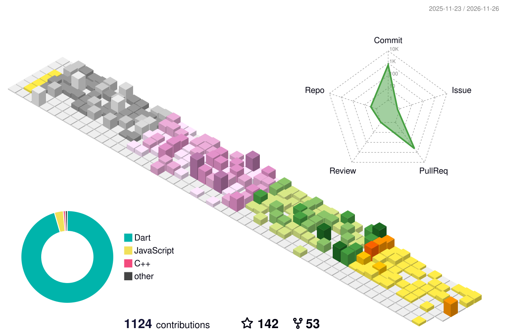

[](https://thebsd.github.io/StandWithPalestine)

<p align="center">
  
</p>

<p align="center">
  <a href="https://github.com/MoazSayed7">
    
  </a>
</p>

<p align="center">
  <a href="https://github.com/TheBSD/StandWithPalestine/blob/main/docs/README.md"></a>
  
  <a href="https://twitter.com/moazr77"></a>
</p>

---

## 👨‍💻 About me


```dart
class MoazSayed {
  final String role = 'Flutter Developer';
  final List<String> stack = ['Dart', 'Flutter', 'Firebase'];
  final String askMeAbout = 'Flutter 💙';
  final String reachMe = 'moazsaid7586@gmail.com';
}
```

- 💬 Ask me about **Flutter**
- 📫 Reach me at **moazsaid7586@gmail.com**
- 📄 My experience: [**Resume.pdf**](https://drive.google.com/file/d/1XMya5SKe0XDRuBuODDDesRHrCrZVbXSB/view?usp=sharing)

<br clear="right" />

## 🌐 Connect with me

<p align="left">
  <a href="https://linkedin.com/in/moazsayed"></a>
  <a href="https://twitter.com/moazr77"></a>
  <a href="https://medium.com/@moaz_sayed77"></a>
  <a href="https://www.youtube.com/@moazsayed"></a>
  <a href="https://stackoverflow.com/users/20260137"></a>
  <a href="https://www.leetcode.com/moazsayed7"></a>
  <a href="https://www.hackerrank.com/moazsaid7586"></a>
  <a href="https://codepen.io/moaz_sayed77"></a>
  <a href="https://instagram.com/moaz_sayed77"></a>
  <a href="https://fb.com/MoazSayed28"></a>
</p>

## 🛠️ Languages & tools

<p align="left">
  
  <br />
  
</p>

<p align="left">
  
  
</p>

## 📊 GitHub stats

<!-- Rendered daily by .github/workflows/stats.yml (includes private repositories). -->
<picture>
  <source media="(prefers-color-scheme: dark)" srcset="profile-3d-contrib/profile-night-rainbow.svg" />
  <source media="(prefers-color-scheme: light)" srcset="profile-3d-contrib/profile-season-animate.svg" />
  
</picture>

<p align="center">
  <picture><source media="(prefers-color-scheme: dark)" srcset="profile/dark/stats.svg" /><source media="(prefers-color-scheme: light)" srcset="profile/light/stats.svg" /></picture>
  <picture><source media="(prefers-color-scheme: dark)" srcset="profile/dark/top-langs.svg" /><source media="(prefers-color-scheme: light)" srcset="profile/light/top-langs.svg" /></picture>
</p>

<p align="center">
  <picture>
    <source media="(prefers-color-scheme: dark)" srcset="https://streak-stats.demolab.com?user=MoazSayed7&border_radius=10&theme=tokyonight&hide_border=true" />
    <source media="(prefers-color-scheme: light)" srcset="https://streak-stats.demolab.com?user=MoazSayed7&border_radius=10&theme=default" />
    
  </picture>
</p>

## 🚀 Featured projects

<p align="center">
  <a href="https://github.com/MoazSayed7/Flutter-Chat-App-Firebase-Authentication-Messaging-WhatsApp-Like"><picture><source media="(prefers-color-scheme: dark)" srcset="profile/dark/pin-chat.svg" /><source media="(prefers-color-scheme: light)" srcset="profile/light/pin-chat.svg" /></picture></a>
  <a href="https://github.com/MoazSayed7/Flutter-Bloc_Cubit-Animated-Auth-Screens-Firebase-Login-SignUp-Reset-SignWithGoogle"><picture><source media="(prefers-color-scheme: dark)" srcset="profile/dark/pin-auth.svg" /><source media="(prefers-color-scheme: light)" srcset="profile/light/pin-auth.svg" /></picture></a>
  <a href="https://github.com/MoazSayed7/airtag-clone"><picture><source media="(prefers-color-scheme: dark)" srcset="profile/dark/pin-airtag.svg" /><source media="(prefers-color-scheme: light)" srcset="profile/light/pin-airtag.svg" /></picture></a>
  <a href="https://github.com/MoazSayed7/FlutterRickAndMortyCubitApp"><picture><source media="(prefers-color-scheme: dark)" srcset="profile/dark/pin-rickmorty.svg" /><source media="(prefers-color-scheme: light)" srcset="profile/light/pin-rickmorty.svg" /></picture></a>
</p>

## 🐍 Contributions

<!-- Rendered by .github/workflows/snake.yml into the `output` branch. -->
<picture>
  <source media="(prefers-color-scheme: dark)" srcset="https://raw.githubusercontent.com/MoazSayed7/MoazSayed7/output/github-snake-dark.svg" />
  <source media="(prefers-color-scheme: light)" srcset="https://raw.githubusercontent.com/MoazSayed7/MoazSayed7/output/github-snake.svg" />
  
</picture>

<p align="center">
  
</p>
